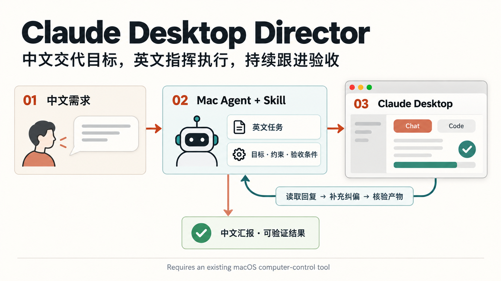

# Claude Desktop Director · Claude 桌面指挥官

Direct Claude Desktop from a Mac agent: turn Chinese goals into English tasks, follow up, and verify the result.

一个面向 macOS 智能体的 skill：你用中文交代目标，智能体把需求整理成英文任务，交给 Claude 桌面应用，持续跟进并核验结果，最后用中文汇报。

当前开发版：**0.2.0-rc1**，聚焦发送确认、任务恢复和记录保护。它是可靠性候选版；[v0.1.0](https://github.com/huliaohaha/claude-desktop-director/releases/tag/v0.1.0) 保留为上一发行版。完整真实桌面任务仍待验证，不能据此宣称稳定无人值守。



图示的文字说明：**中文目标 → 英文任务 → Claude 桌面应用 → 观察反馈 → 核验产物 → 中文交付**。发现缺项或错误时，回到 Claude 发送具体的增量指令；中断时保存进度，恢复前核对实际会话和产物。

## 解决什么问题

- **不想反复组织英文需求**：保留原意、事实和约束，补齐输入、范围、交付物与验收条件。
- **发完一句还得自己盯着**：读取 Claude 的回复，回答范围内的普通实现问题，针对缺项继续推进。
- **长文本容易输错、发错会话或重复发送**：发送前核对会话和编辑框，发送后确认消息确实出现。
- **Claude 说“完成”却没有可用结果**：区分方案、执行自述、实际产物和独立验证，按证据验收。
- **任务中断后需要重讲背景**：长任务保留简报、最后指令和待办，恢复时接续已完成的工作。

英文是默认工作语言选择，不代表必然提高模型能力或节省额度。用户要求中文交付物时，英文任务仍会明确要求产物使用中文。

## 0.2.0-rc1 的变化

- **明确发送未知状态**：区分 `not-sent / sending / unknown / confirmed / failed-no-effect`，超时后先找原消息；找到匹配回显后可以继续，不能盲目重发。
- **把核对依据写清楚**：稳定 Task-ID、每条独立 Message-ID，以及目标、完整读回和回显证据。编号和哈希帮助核对，不保证服务端只执行一次。
- **补齐记录保护**：检查实际目标项目的忽略和跟踪状态；短任务复用宿主记录，长任务才按需持久化，不强制每条消息先建日志目录。
- **增加可复核素材**：离线状态校验器、回归测试、行为/触发场景和最小权限 CI；这些检查与真实桌面验证分别报告。

升级取舍和借鉴的具体机制见 [版本变更](CHANGELOG.md) 与 [评估规范](claude-desktop-director/references/evaluation.md)。

## 安装

安装当前候选版，把其中的 **`claude-desktop-director/` 子目录**复制到技能目录。仓库根目录包含公开说明和文档，不是 skill 的安装目录。只用 Markdown 技能不需要 Python；离线校验工具需要 Python 3.10+，没有第三方 Python 依赖。

```sh
git clone --branch v0.2.0-rc1 --depth 1 https://github.com/huliaohaha/claude-desktop-director.git
cd claude-desktop-director

skill_root="${CODEX_HOME:-$HOME/.codex}/skills"
skill_target="$skill_root/claude-desktop-director"

if [ -e "$skill_target" ] || [ -L "$skill_target" ]; then
  printf '目标已存在，请先检查现有技能，未进行覆盖：%s\n' "$skill_target" >&2
  false
else
  mkdir -p "$skill_root" && cp -R ./claude-desktop-director "$skill_target"
fi
```

让宿主按其方式重新加载技能。其他支持 `SKILL.md` 的 Mac 智能体可将同一子目录放入各自的技能目录，并映射其实际电脑操作工具；这里的安装命令面向 Codex 的技能目录约定。

已有安装时，先比较本地改动并备份，再人工替换技能目录；不要用 `cp -R` 向旧目录叠加，避免留下旧版文件。上面的保护分支会返回非零状态，不会自动覆盖。当前没有自动升级或回滚安装器。

## 使用

直接在支持该技能的智能体中输入：

```text
使用 $claude-desktop-director，让 Mac 上的 Claude 桌面版修复当前项目
登录成功后又跳回登录页的问题。不要修改注册流程，完成后验证并用中文汇报。
```

也可以用于写作、分析、资料整理等任务，不限于软件开发：

```text
使用 $claude-desktop-director，让 Claude 根据我提供的材料整理一份中文说明，
区分已有证据和待确认结论。缺少材料时先指出具体缺项。
```

只需要英文提示词时，明确说明即可，此时不会操作 Claude：

```text
使用 $claude-desktop-director，只帮我写给 Claude 的英文任务，不发送：
检查这份报告中的数字、单位和引用，保留中文正文。
```

需要只读预览时可说“检查当前 Claude 桌面任务如何继续，先别发，也别填编辑框”。`prompt-only / preview / execute / resume` 四种模式分别约束本轮动作，不改变用户的原始任务授权。

接续任务时可以说“继续刚才让 Claude 做的任务”。技能会先核对原会话和已有结果，避免重新开工。若目标会话、目录或关键事实无法可靠确定，仍会询问必要信息。

## 如何工作

1. **理解目标**：确认输入、可修改范围、交付语言和完成条件。开发项目先检查现状与仓库指令，并寻找可复用的 GitHub 项目。
2. **整理英文任务**：传达目标与约束，清楚区分研究、规划、审查和实际实施。
3. **核对并发送**：观察当前窗口、模式、会话及目录，保留已有草稿，读回输入内容后发送，再确认消息已出现。
4. **跟进与纠偏**：等待运行中的工作，对缺项、错误或用户补充发送具体续问，不反复只发 “continue”。
5. **核验并交付**：检查可访问的文件、diff、测试输出、来源或导出成品，用中文说明结果与实际限制。

长任务可在受保护位置保存最小简报与进度；若使用目标项目的 `.claude-director/<task-id>/`，须先核对该项目实际忽略、跟踪和权限状态。本仓库的 `.gitignore` 不会自动保护其他项目。记录用于恢复；结束本轮后的持续检查需要实际建立用户要求的调度。

用户指定的预算或宿主限制会约束本轮调度；未指定时不预设三轮或二十分钟的停工上限。停止调度、停止 Claude 内部工作和回滚已执行修改是不同的动作。

## 能力依赖与边界

- 需要 macOS、可用的 Claude 桌面应用，以及宿主智能体提供的原生应用控制、Accessibility 或截图与输入工具。系统权限按所用工具的要求配置。
- skill 本身是工作指令，不附带点击引擎，也不安装后台服务。优先使用宿主已有工具；没有电脑操作能力时，只能交付英文任务并说明缺少的能力。
- 普通聊天不因收到本机路径就能读取文件。需要附件或项目访问时，应通过实际可用的入口提供，并确认访问范围。
- 应用内 Code 等执行模式是否可用、能访问哪些目录，以实时界面为准。“回复了代码”不等于“已写入本地文件”。
- 沿用用户授权的任务范围。外部发布、付费、删除或扩大访问权限等新增操作，需要处理该具体步骤的授权；不修改账号、网络或订阅设置来绕过阻塞。

**Claude 桌面应用与 Claude Code CLI 是不同入口。** 本技能操作桌面应用内的会话和实际可用模式，不会因为本机存在 `claude` 命令就切换到终端或 API。纯 CLI / SDK 自动化、账号与网络故障处理不在当前范围内。

## 验证状态

当前已做技能格式检查与模拟场景验证；**尚未完成一个真实 Claude 桌面任务的完整端到端验证**。模拟验证不能证明所有 Claude 版本、界面模式和电脑控制后端都可用。使用时必须依据当前工具文档和实时界面定位控件，不依赖固定坐标或旧元素编号。

另已在临时目录完成公开仓库的匿名克隆、README 安装命令和已有技能防覆盖检查；图片公开链接已核对。具体范围和复核方法见 [验证记录](docs/validation.md)。

在仓库根目录复核离线部分：

```sh
python3 tools_validate.py
python3 -m unittest discover -s tests -v
python3 claude-desktop-director/scripts/check_state.py claude-desktop-director/assets/task-state.example.json
```

状态校验器只检查记录内部是否一致，不连接 Claude、不点击 UI、不验证证据真假，也不提供写锁、原子记录写入器或后台调度。候选后端只有文档映射时标记为 `documented-not-tested`；列出项目链接不代表已经适配。

## 相关项目与定位

本项目先调研已有方案，聚焦上层的任务组织、会话跟进和验收，不重写底层 Mac 自动化框架，也未复制下列项目的代码。

| 项目 | 与本技能的关系 |
| --- | --- |
| [Peekaboo](https://github.com/openclaw/Peekaboo) | macOS 截图、Accessibility 和 UI 操作；没有现成电脑工具时的候选后端。 |
| [MacOS-MCP](https://github.com/CursorTouch/MacOS-MCP) | 为 MCP 客户端提供 Mac 应用与界面操作；可评估的替代后端。 |
| [Claude Code](https://github.com/anthropics/claude-code) | 官方终端编程代理；不是控制桌面聊天的 API。 |
| [Claude Agent SDK for Python](https://github.com/anthropics/claude-agent-sdk-python) | 可参考消息循环和会话反馈设计；使用本技能无需额外安装 SDK。 |
| [agent-browser](https://github.com/vercel-labs/agent-browser) | 借鉴引用生命周期与内容信任边界，不将浏览器控制当成原生桌面后端。 |
| [Anthropic skill-creator](https://github.com/anthropics/skills/tree/main/skills/skill-creator) | 借鉴修改前后对照、独立评估和触发测试。 |
| [LangGraph](https://github.com/langchain-ai/langgraph) | 借鉴恢复时检查副作用的原则；本项目不依赖该框架。 |

候选后端不是必装依赖，通常选择一种已有且可用的电脑控制方式即可。安装前应核对其官方仓库当前的兼容性与权限要求。

## 文件与贡献

- [SKILL.md](claude-desktop-director/SKILL.md)：技能入口与工作规则。
- [桌面操作与恢复](claude-desktop-director/references/desktop-control.md)：输入、发送确认、观察与中断恢复。
- [英文任务模板](claude-desktop-director/references/task-templates.md)：首次任务、纠偏和接续示例。
- [发送与恢复协议](claude-desktop-director/references/protocol.md)：发送状态、证据和预算。
- [安全与记录保护](claude-desktop-director/references/safety.md)：不可信材料、授权和目标项目日志。
- [后端能力契约](claude-desktop-director/references/backend-contract.md)：执行前必须确认的语义能力。
- [可复用工具选型](claude-desktop-director/references/reuse.md)：现有工具与后端选择。

欢迎报告可复现的问题或提交适配改进，见 [贡献指南](CONTRIBUTING.md)。介绍图由内置图像生成工具生成，其 [提示词与制作说明](docs/assets/workflow.prompt.md) 随仓库保存。

## 许可

本项目使用 [MIT License](LICENSE)。这是独立社区项目，与 Anthropic、OpenAI 无隶属关系，也未获得其官方认可；Claude 等名称及商标属于各自权利人。
